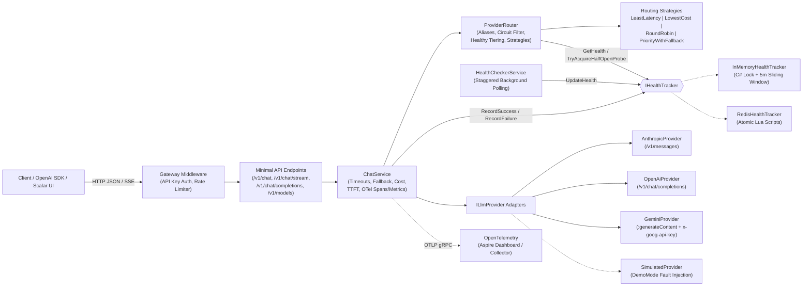

# LlmRouter

[](https://github.com/fss528/LlmRouter/actions/workflows/ci.yml)


A multi-provider **LLM request gateway and router** built with **C# / .NET 10** and Clean Architecture.

`LlmRouter` decouples applications from single AI model vendors by exposing unified provider-neutral (`/v1/chat`, `/v1/chat/stream`) and OpenAI-compatible (`/v1/chat/completions`) endpoints across **Anthropic**, **OpenAI**, and **Google Gemini**—complete with logical model aliasing, cross-provider fallback, cost-aware and P95-latency routing, SSE streaming with TTFT tracking, single-flight half-open circuit breakers, Redis distributed state, and OpenTelemetry observability.

---

## Architecture



---

## Key Capabilities

- **Logical Model Aliasing & Cross-Provider Fallbacks:** Route by capability tiers (`fast`, `balanced`, `reasoning`, `chat-default`) or concrete model IDs with configurable cross-provider fallback chains (`ModelRoutingCatalog`).
- **4 Routing Strategies:**
  - `LeastLatency`: orders healthy measured candidates by sliding-window **P95 latency** (unhealthy or cold-start unmeasured providers never hijack traffic from fast measured providers).
  - `LowestCost`: selects the lowest estimated USD token cost per 1M input/output tokens, breaking ties by latency.
  - `RoundRobin`: rotates evenly across request scopes via singleton atomic `IRoundRobinState`.
  - `PriorityWithFallback`: preserves explicit catalog / DI priority order.
- **Resilience & Single-Flight Circuit Breaker:**
  - Opens at `> 50%` error rate over a 5-minute sliding window (`>= 5` requests), cools down for 30s, and enforces **single-flight `HalfOpen` probing** (`TryAcquireHalfOpenProbe`) to prevent recovery thundering herds.
  - Separates non-retriable client payload errors (`400`/`422` `ProviderClientException`) from transient/provider faults (`429`, `5xx`, timeouts, `401`/`403`) so bad user prompts never trip provider circuit breakers.
- **SSE Streaming & TTFT Measurement:** True Server-Sent Events across Anthropic, OpenAI, and Gemini (`POST /v1/chat/stream`), with transparent failover *before* the first token is committed to the client and **Time-To-First-Token (TTFT)** instrumentation.
- **OpenAI-Compatible Surface:** Drop-in `POST /v1/chat/completions` (JSON + SSE `stream: true`) supporting `X-Routing-Strategy` header and `X-LlmRouter-*` telemetry response headers.
- **Dual State Store (`InMemory` & `Redis`):** Dependency-free `InMemoryHealthTracker` using .NET `Lock` + `TimeProvider`, or multi-replica `RedisHealthTracker` using cluster-safe atomic Lua scripts.
- **Observability & Gateway Controls:** Built-in `ActivitySource` + `Meter` instruments exported via **OpenTelemetry** (traces, tokens, USD cost, fallbacks, latency & TTFT histograms), fixed-window rate limiting, and optional constant-time API key authentication.

---

## Project Structure

```text
LlmRouter/
├── LlmRouter.sln
├── Dockerfile
├── docker-compose.yml
├── docs/
│   └── adr/                              # Architecture Decision Records
├── benchmarks/
│   └── LlmRouter.Benchmarks/             # BenchmarkDotNet microbenchmarks
├── src/
│   ├── LlmRouter.Core/                   # Pure domain & routing engine (0 NuGet dependencies)
│   ├── LlmRouter.Infrastructure/         # Provider adapters, Redis Lua tracker, Simulated demo mode
│   └── LlmRouter.Api/                    # Minimal API, OpenAI compat, SSE, OTel, Scalar/OpenAPI
└── tests/
    └── LlmRouter.Tests/                  # 60 unit & WebApplicationFactory integration tests
```

---

## Quick Start: 1-Command Docker Demo (No API Keys Required)

Run the full stack (**LlmRouter in DemoMode + Redis + .NET Aspire OpenTelemetry Dashboard**) with one command:

```bash
docker compose up --build
```

Once running:
- **Scalar API UI:** `http://localhost:8080/scalar/v1`
- **Aspire Telemetry Dashboard (Traces & Metrics):** `http://localhost:18888`

### Trigger a live cross-provider failover

Send a request to the `"fast"` tier while injecting a simulated `429 TooManyRequests` on `Gemini`:

```bash
curl -X POST http://localhost:8080/v1/chat \
  -H "Content-Type: application/json" \
  -H "X-Simulate-Failure: Gemini" \
  -d '{
    "model": "fast",
    "messages": [{"role": "user", "content": "Explain circuit breakers in two sentences."}],
    "strategy": "PriorityWithFallback"
  }'
```

`LlmRouter` automatically fails over from `Gemini` (`gemini-2.5-flash`) to `OpenAI` (`gpt-4o-mini`), returns `attempts` showing the 429 + fallback, updates Redis circuit metrics, and emits the full distributed trace to the Aspire Dashboard.

---

## Running Locally with Real Provider Keys

### Prerequisites

- [.NET 10 SDK](https://dotnet.microsoft.com/download/dotnet/10.0)
- One or more provider API keys (`GEMINI_API_KEY`, `OPENAI_API_KEY`, `ANTHROPIC_API_KEY`)

### Configure & Run

```powershell
$env:GEMINI_API_KEY = "your-gemini-key"
$env:OPENAI_API_KEY = "your-openai-key"
$env:ANTHROPIC_API_KEY = "your-anthropic-key"

dotnet restore .\LlmRouter.sln
dotnet build .\LlmRouter.sln --configuration Release --no-restore
dotnet test .\LlmRouter.sln --configuration Release --no-build
dotnet run --project .\src\LlmRouter.Api\LlmRouter.Api.csproj
```

Interactive API documentation is available at `https://localhost:7225/scalar/v1` (or `http://localhost:5136/scalar/v1`), and sample requests live in [LlmRouter.Api.http](src/LlmRouter.Api/LlmRouter.Api.http).

---

## API Reference

| Endpoint | Description |
|---|---|
| `POST /v1/chat` | Provider-neutral chat completion with cost estimation and `attempts` trace |
| `POST /v1/chat/stream` | Server-Sent Events (`text/event-stream`) with TTFT and final usage/cost `done` event |
| `POST /v1/chat/completions` | OpenAI-compatible chat completions (`stream: false` and `stream: true`) |
| `GET /v1/models` | Discovers logical tiers (`fast`, `balanced`, `reasoning`, `chat-default`), fallback chains, and pricing |
| `GET /health/providers` | Live per-provider health, `CircuitState`, P95 latency, sample count, and 5-min error rate |
| `GET /health` | ASP.NET Core readiness/liveness check (includes Redis check when enabled) |
| `GET /openapi/v1.json` & `/scalar/v1` | OpenAPI spec & interactive Scalar reference |

### Logical Model Tiers (Default Catalog)

| Alias | Ordered Targets |
|---|---|
| `fast` | `Gemini:gemini-2.5-flash` → `OpenAI:gpt-4o-mini` → `Anthropic:claude-haiku-4-5-20251001` |
| `balanced` | `OpenAI:gpt-4o` → `Anthropic:claude-sonnet-4-20250514` → `Gemini:gemini-2.5-flash` |
| `reasoning` | `Anthropic:claude-opus-4-20250514` → `Gemini:gemini-2.5-pro` → `OpenAI:gpt-4o` |
| `chat-default` | `Gemini:gemini-2.5-flash` → `OpenAI:gpt-4o-mini` → `Anthropic:claude-haiku-4-5-20251001` |

Aliases, cross-provider fallback chains, and per-1M-token USD pricing are extensible via the `Routing` configuration section in `appsettings.json`.

---

## Performance Benchmarks

Measured with [BenchmarkDotNet](benchmarks/LlmRouter.Benchmarks/RouterBenchmarks.cs) on `.NET 10.0.12` (`X64 RyuJIT x86-64-v3`, Intel Core Ultra 7 155H, `ShortRun` job):

```powershell
dotnet run -c Release --project benchmarks/LlmRouter.Benchmarks/LlmRouter.Benchmarks.csproj -- --job short --filter *RouterBenchmarks*
```

| Method | Mean | StdDev | Allocated |
|---|---:|---:|---:|
| `HealthTracker_RecordAndSnapshot` | 1.304 μs | 0.031 μs | 2.27 KB |
| `Resolve_PriorityWithFallback` | 3.779 μs | 0.181 μs | 5.33 KB |
| `Resolve_RoundRobin` | 4.404 μs | 0.479 μs | 6.00 KB |
| `Resolve_LowestCost` | 5.183 μs | 0.041 μs | 6.61 KB |
| `Resolve_LeastLatency` | 5.453 μs | 0.114 μs | 6.52 KB |

Routing and health tracking add **< 6 microseconds** of overhead per request—negligible relative to 200–2,000 ms upstream LLM inference latencies.

---

## Architecture Decision Records

Design decisions and tradeoffs are documented in [docs/adr/](docs/adr/):

- [ADR 0001: Ordered Route Resolution and Logical Model Aliasing](docs/adr/0001-ordered-fallback-and-model-aliasing.md)
- [ADR 0002: Custom Circuit Breaker with Single-Flight Half-Open Probing](docs/adr/0002-circuit-breaker-half-open-single-flight.md)
- [ADR 0003: Dual In-Memory and Redis Atomic Lua Health State Store](docs/adr/0003-in-memory-vs-redis-health-state.md)
- [ADR 0004: SSE Streaming Fallback Boundary and TTFT Instrumentation](docs/adr/0004-sse-streaming-fallback-boundary.md)

---

## Test Suite

The solution includes 60 unit and integration tests covering:
- Logical model resolution, cross-provider fallback chains, and `UnsupportedModelException`
- All 4 routing strategies (`LeastLatency`, `LowestCost`, `RoundRobin` across scopes, `PriorityWithFallback`)
- Sliding-window expiry, P95 latency, cold-start/unhealthy isolation, single-flight `HalfOpen` gating, and concurrent thread-safety
- Non-retriable `400`/`422` client error isolation vs `429`/`5xx`/timeout failover
- Wire-level `HttpMessageHandler` verification for Anthropic, OpenAI, and Gemini (including `x-goog-api-key` header hygiene and SSE chunk parsing)
- `RedisHealthTracker` Lua snapshot parsing and atomic probe locking
- `HealthCheckerService` staggered polling
- End-to-end Minimal API integration tests (`WebApplicationFactory`) for `/v1/chat`, `/v1/chat/stream`, `/v1/chat/completions`, `/v1/models`, `/health/providers`, `/openapi/v1.json`, gateway API key auth, and rate limiting

## License

MIT. See [LICENSE](LICENSE).
